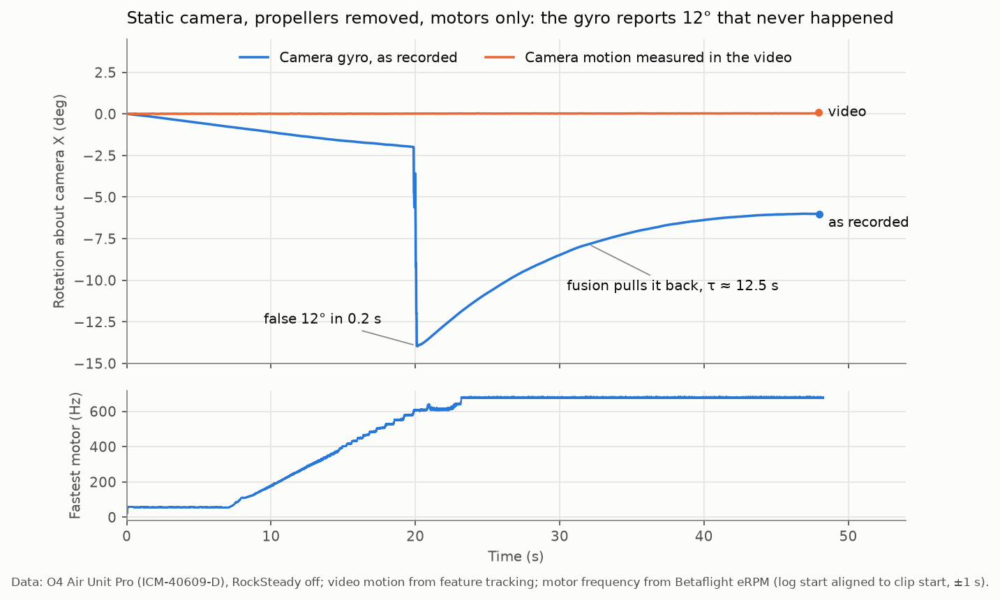

# o4fix

DJI O4 Air Unit Pro units built since about February 2026 use a different gyro, the TDK ICM-40609-D (marked I469D), and record rotations that never happened. RockSteady and Gyroflow faithfully "correct" for them, so clean footage comes out with sudden jerks and slow sway. This repository documents the fault, proposes a firmware fix, and provides a tool that repairs already-recorded footage for Gyroflow.



*A static O4 Air Unit Pro on a table, propellers removed. With only the motors spinning, the camera records a 12° rotation in 0.2 s, then slowly pulls it back. The video itself moved less than 0.1°.*

## Findings

- **Reproducible without flying.** A static camera with propellers removed recorded a false 12° step when one motor passed about 600 Hz. The same camera rotated by hand at up to 700 °/s without vibration stays accurate. The trigger is vibration.
- **Likely cause: a missing initialisation write.** The ICM-40609-D datasheet says bits 7:6 of `INTF_CONFIG1` (0x4D) reset to `10` and "must be set to 01 for normal device operation". On the sibling ICM-42688-P, writing `01` there disables AFSR, which ArduPilot and Betaflight turn off because it stalls the gyro output and causes drift. Neither project does this for the ICM-40609. DJI's firmware is encrypted, so what DJI writes could not be checked.
- **Signature in flight.** Compared with a Betaflight blackbox, the false rotations are short bursts on a single gyro axis. Their rate grows from 0.02/s below 2 g to 11.8/s at 4–5 g. The camera's fusion then pulls each error back with a time constant of about 12.5 s.

The full analysis, data and limits are in [docs/REPORT.md](docs/REPORT.md).

**Proposed fix for DJI:** at gyro initialisation, `INTF_CONFIG1 (0x4D) = (INTF_CONFIG1 & 0x3F) | 0x40`, which turns 0x91 into 0x51.

## Repairing your footage

`o4fix` reads the 1 kHz attitude quaternions embedded in the MP4 and removes the false bursts together with the pull-back they trigger. It then writes the corrected values back into a copy of the file, so Gyroflow opens it like any DJI clip, with lens profile, sync and orientation intact. The original file is never modified.

Record with **RockSteady and HorizonSteady OFF**; otherwise the camera does not store the 1 kHz track. Requires Python 3.9+.

```bash
pipx install git+https://github.com/vadimbryl/o4fix      # or: pip install git+https://github.com/vadimbryl/o4fix
o4fix fix DJI_20260513161109_0059_D.MP4                    # writes DJI_20260513161109_0059_D_o4fix.MP4
```

Options: `-o OUT.MP4`, `--force` (overwrite an existing output), `--dry-run`, and the tuning parameters `--impulse-thr` (60 °/s), `--lpf` (20 Hz), `--busy-lpf` (3 Hz) and `--pullback-tau` (12.5 s).

Results against references:

| | As recorded | o4fix |
| --- | --- | --- |
| Bench clip, false step left after the event | 11.8° | 0.3° or less |
| Public flight vs blackbox, false rotation per video frame (p99 / max) | 1.75° / 4.93° | 0.45° / 1.81° |
| Second airframe, worst flight vs blackbox (p99 / max) | 0.30° / 4.11° | 0.19° / 0.69° |
| Clean clips (no false events) | unchanged | unchanged |

**Limits:**
- o4fix removes most of the false motion, not all of it. Sustained false rates and some slow wobble remain on the hardest full-throttle segments.
- Footage recorded with RockSteady on cannot be repaired.

## This is a workaround, not a fix

o4fix makes affected footage noticeably better, but it does not fully fix the problem: some false motion remains, and nothing can recover what the gyro never measured correctly. The real fix has to come from DJI, most likely as a firmware change to the gyro initialisation (see the [report](docs/REPORT.md)).

This is a hobby project shared as is, with no claims and no guarantees. Try it on your clips. If you have ideas, measurements or a better algorithm, fork it, experiment, and open an issue or a pull request.

## Testing your own unit

The checks need the `tools` extra (OpenCV, orangebox, matplotlib):

```bash
pipx install "o4fix[tools] @ git+https://github.com/vadimbryl/o4fix"
```

- **Static test.** Quad on a table, propellers removed, RockSteady off, motors raised slowly in the Betaflight Motors tab:
  ```bash
  o4fix check-static CLIP.MP4
  ```
  It prints any attitude change the gyro recorded that the video does not confirm.
- **Flight with a Betaflight blackbox** (raw gyro logged):
  ```bash
  o4fix compare-blackbox CLIP.MP4 LOG.BBL
  ```
  It reports the false rotation before and after o4fix.

## Development

```bash
git clone https://github.com/vadimbryl/o4fix && cd o4fix
python -m venv .venv && . .venv/bin/activate
pip install -e ".[tools,dev]"
pytest && ruff check . && ruff format --check .
```

The tests use a synthetic MP4 with a DJI attitude track, so no recordings are needed. `scripts/make_figures.py` rebuilds `docs/figures` from the recordings described in the report.

| Path | Contents |
| --- | --- |
| `src/o4fix/dji.py` | MP4 and protobuf parsing, in-place patching of the attitude track |
| `src/o4fix/correction.py` | Removal of false bursts and of the fusion pull-back, adaptive low-pass |
| `src/o4fix/quat.py` | Quaternion helpers |
| `src/o4fix/static_check.py`, `src/o4fix/blackbox.py` | `check-static` and `compare-blackbox` |
| `src/o4fix/cli.py` | Command line |
| `tests/` | Unit tests |
| `docs/REPORT.md` | Technical report |

## Disclaimer

This is an independent investigation. It is not affiliated with or endorsed by DJI or TDK InvenSense. DJI, O4, RockSteady and HorizonSteady are trademarks of SZ DJI Technology Co., Ltd. The register analysis is an inference from public datasheets and open-source drivers. No DJI firmware or TDK documents are redistributed here.

## License

[MIT](LICENSE)
