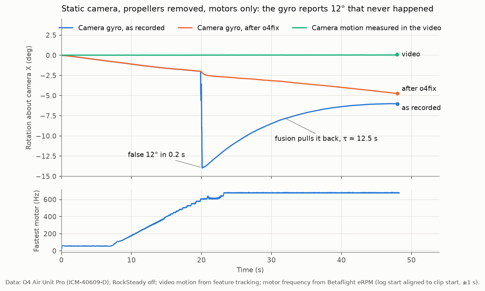
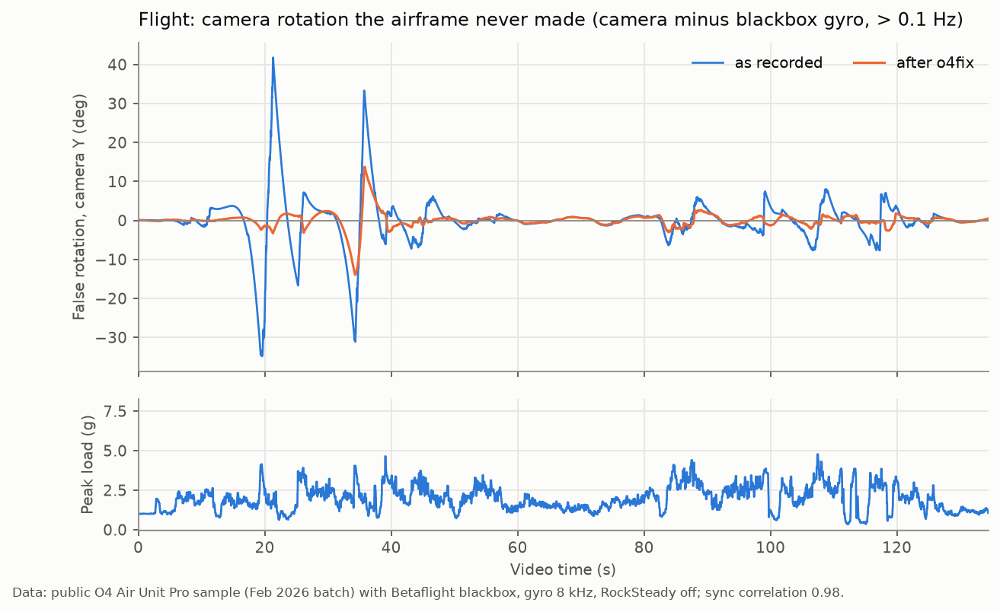

# False gyro readings in DJI O4 Air Unit Pro units with the ICM-40609-D

**Summary.** Since about February 2026, DJI O4 Air Unit Pro cameras ship with a TDK ICM-40609-D gyro (marked I469D) instead of the earlier MP66. These units record rotations that never happened. RockSteady and Gyroflow then "correct" for those rotations, which shows up as jerks and slow sway in otherwise clean footage.

The fault reproduces on a table: propellers removed, camera untouched, motors spinning. In that test the camera recorded a 12° rotation in 0.2 s while its own video moved less than 0.1°.

The ICM-40609-D datasheet requires one register write after power-up "for normal device operation". On the sibling ICM-42688-P, the same bits disable a mode (AFSR) that ArduPilot and Betaflight turn off because it makes the gyro output stall and drift. We could not verify what DJI's encrypted firmware writes. We propose that write as the fix, and provide a tool that repairs already-recorded footage.

Date: October 2026. Firmware analysed: O4 Air Unit Pro (model code za5305) v01.00.03.00 to v01.00.07.00.

## 1. What changed in the hardware

| Units | Gyro | Stabilisation |
| --- | --- | --- |
| O4 Air Unit Pro, 2025 production | MP66 (MPU-66xx family) | Works hard-mounted |
| O4 Air Unit Pro, production from about Feb 2026 | ICM-40609-D (I469D) | Jerks and sway |
| O4 Air Unit / O4 Lite, since launch | ICM-40609-D (I469D) | Known to need soft mounts |

Users report three things. Swapping a 2025 camera back onto the same airframe removes the problem. Re-soldering an MP66 onto a 2026 board removes it too. Betaflight blackbox gyro data from the same flight stabilises the same video cleanly. The fault follows the chip, not the airframe ([DJI forum thread](https://forum.dji.com/forum.php?mod=viewthread&tid=351646&page=1), [Oscar Liang](https://oscarliang.com/dji-o4-pro-gyro-stabilization-issue/)).

## 2. The register

| | ICM-40609-D ([DS-000330 rev 1.2](https://datasheet.lcsc.com/datasheet/pdf/b9c51c24eaeae06cc0abef39787cb772.pdf?productCode=C5360621), §13.28) | ICM-42688-P (DS-000347 rev 1.9, §14.35) |
| --- | --- | --- |
| INTF_CONFIG1 (0x4D) reset value | 0x91 (bits 7:6 = `10`) | 0x91 (bits 7:6 = `10`) |
| Bits 7:6 | `EN_TEST_MODE`: "Must be set to 01 for normal device operation." | Reserved (undocumented) |
| Written by ArduPilot / Betaflight | No | Yes: `(v & 0x3F) \| 0x40`, which disables AFSR |

On ICM-426xx parts, AFSR (adaptive full-scale range) is on by default. [ArduPilot PR #25332](https://github.com/ArduPilot/ardupilot/pull/25332) found that the gyro output gets stuck for about 2 ms when AFSR switches near 100 °/s, producing a DC bias large enough to crash vehicles. [ArduPilot](https://github.com/ArduPilot/ardupilot/blob/master/libraries/AP_InertialSensor/AP_InertialSensor_Invensensev3.cpp) and [Betaflight](https://github.com/betaflight/betaflight/blob/master/src/main/drivers/accgyro/accgyro_spi_icm426xx.c) both now disable it.

Neither project touches these bits on the ICM-40609. The MP66 has no such register, so a driver carried over from it would leave the ICM-40609-D in its reset state.

Two limits apply:
- DJI firmware modules are signed and AES-encrypted with keys that are not public, so DJI's actual initialisation could not be inspected.
- TDK does not say that EN_TEST_MODE is AFSR. That is an inference from the identical register, bits and reset value.

## 3. Reproduction on a table

**Setup.** An O4 Air Unit Pro from a 2026 batch, RockSteady off, on a quad standing on a table. Propellers removed, nothing touching the camera. Motors raised slowly from the Betaflight Motors tab, with the blackbox logging motor eRPM.

**Ground truth.** The camera does not move, so its correct attitude is constant. `o4fix check-static` ([source](../src/o4fix/static_check.py)) measures the real camera motion from the video itself: feature tracking gives image rotation about the optical axis and image shift, and the shift is converted to degrees with the lens focal length.



| Measurement, 48 s clip | Value |
| --- | --- |
| Attitude change the camera recorded | 14.1° maximum, of which 11.84° is a single false step |
| Duration of the false step | 0.22 s (19.88–20.10 s), a burst of impulses up to 450 °/s on one axis |
| Camera motion measured in the video | 0.084° maximum (rotation 0.03°, shift 2.5 px) |
| Fastest motor at the event | about 580–610 Hz (other motors about 440 Hz, 150 Hz, idle; log aligned ±1 s) |
| Recovery after the step | exponential, τ = 12.1–12.8 s, fit residual 0.02–0.14° |

The slow return is the camera's own attitude fusion pulling the false step back. A stabiliser therefore sees a sudden jerk followed by about 30 s of slow sway, all of it false.

The clip also shows a background drift of about 0.1 °/s per axis, with no motion in the video. That is ordinary gyro bias and is much smaller than the event.

A second run, with throttle jerks reaching only about 510 Hz, showed no event. Rotating the same camera by hand at up to 700 °/s, with dozens of crossings of 100 °/s and no vibration, stayed within 0.35° per frame of the blackbox gyro. The trigger is vibration, not rotation, and it does not depend on the mount.

## 4. Flight data against a blackbox

**Dataset.** A public O4 Air Unit Pro sample from the Feb 2026 batch: 135 s of flight, RockSteady off, Betaflight blackbox with gyro at 8 kHz. The camera stream was synchronised to the blackbox (correlation 0.98), including the drift between the two clocks, which is about 1 ms per second and would otherwise misalign long clips by tenths of a second. The fixed camera-to-FC rotation was fitted: 180° about roll plus about 25° uptilt. "False rotation" below means camera attitude minus flight-controller attitude.



**What the camera writes.** 1000 unique attitude quaternions per second, each stored twice, in the `djmd` track. The stream is band-limited by a steep filter, −3 dB at about 143 Hz and −53 dB at 185 Hz.

**The false rotations:**

| Property | Measurement |
| --- | --- |
| Shape | Short bursts on exactly one gyro axis (axis purity 0.99) |
| Size | Clusters around 0.65°, then 1.3° and 2.0° |
| Per video frame | 99th percentile 1.75°, maximum 4.93° |
| Above 10 Hz | Camera reports 5–14 °/s; the FC sees 0.3–1.7 °/s; coherence between them 0.01–0.04 |

**Dependence on load:**

| Peak load in a 0.5 s window | False impulses per second |
| --- | --- |
| below 2 g | 0.02 |
| 2–3 g | 0.9 |
| 3–4 g | 3.6 |
| 4–5 g | 11.8 |

**The accelerometer is not the source.** A tilt correction from the accelerometer can only rotate about horizontal axes. The impulse axes are spread like random sensor axes: 39% near horizontal against 33% for a random axis, and 20% close to vertical.

**Second airframe.** Three clips from two more flights on another O4 Air Unit Pro (2026 batch), each with a Betaflight blackbox:

| Clip | Length | False rotation per frame, p99 / max | Notes |
| --- | --- | --- | --- |
| Flight 1, part 1 | 285 s | 0.30° / 4.11° | Two episodes of dense alternating false rates on one axis, ±100–300 °/s for 0.6–1.5 s while the FC sees under 10 °/s |
| Flight 1, part 2 | 237 s | 0.05° / 0.18° | Clean |
| Flight 2 | 96 s | 0.06° / 0.36° | Clean |

The same unit, recorded earlier with RockSteady on (per-frame attitude only), showed false rotation rising from about 5 °/s RMS at cruise (motors at 160–220 Hz) to 200–690 °/s RMS with the motors at 500–540 Hz. The fault is intermittent: on this airframe most flying is clean, and the false content arrives in episodes.

**Ruled out:** aliasing of motor tones. No relation between the false content and k·f_motor ± n·f_s was found for sample rates from 250 to 1100 Hz.

## 5. Repairing recorded footage: o4fix

Without raw gyro samples, what the gyro lost cannot be recovered exactly. Most of the false motion has a recognisable structure, though, and [o4fix](../src/o4fix/correction.py) removes it in three steps:

1. **Bursts.** Impulses on one axis that stand out from the running median, while the other axes stay comparatively quiet, are grouped into bursts when they are less than 80 ms apart, or up to 120 ms apart when the rate in between jitters sample to sample like false content (a real manoeuvre is smooth at 1 kHz). Each burst is replaced by a straight line between the clean rates just before and after it.
2. **Fusion pull-back.** Each removed burst would otherwise leave its exponential pull-back (τ = 12.5 s) as an opposite drift, so that pull-back is subtracted too.
3. **Smoothing.** A zero-phase 20 Hz low-pass, moving to 3 Hz where removal is heavy, typically at full throttle.

The corrected quaternions are written back into a copy of the MP4 at the same byte positions, so Gyroflow reads it as a normal DJI file.

| Result | As recorded | o4fix |
| --- | --- | --- |
| Bench clip: false step removed | 0° | 11.84° of 11.84° |
| Bench clip: error after the event, at 20.2 / 30 / 47 s | −11.8° / −5.4° / −1.0° | −0.14° / −0.02° / +0.26° |
| Public flight: false rotation per frame, p99 / max | 1.75° / 4.93° | 0.45° / 1.81° |
| Public flight, camera Y axis: false rotation RMS at 0.1–0.3 / 0.3–1 / 1–3 / 3–10 Hz | 6.77° / 1.77° / 0.44° / 0.16° | 2.02° / 0.62° / 0.13° / 0.03° |
| Second airframe, flight 1 part 1: per frame p99 / max | 0.30° / 4.11° | 0.19° / 0.69° |
| Second airframe, clean clips: per frame p99 / max | 0.05–0.06° / 0.18–0.36° | 0.05–0.06° / 0.20° |

Bench errors are measured against the video and exclude the 0.1 °/s bias drift. Flight figures are measured against the blackbox with `o4fix compare-blackbox` ([source](../src/o4fix/blackbox.py)).

**Limits.** Some false motion remains:
- **Sustained false rates.** About 1 s of +60–70 °/s on one axis at 34–36 s of the public sample is not impulse-like enough to be removed.
- **Slow wobble.** About 2° RMS below 0.3 Hz on the worst axis of the public sample, where it overlaps real motion.
- **Tuning data.** Parameters were chosen on four clips from two airframes; other frames, mounts and settings may need different values.

The gyro bias drift is left alone. Footage recorded with RockSteady on cannot be repaired, because the correction is already baked into the image.

## 6. Proposed fix and how to verify it

At ICM-40609-D initialisation, in register bank 0:

```
INTF_CONFIG1 (0x4D) = (INTF_CONFIG1 & 0x3F) | 0x40      // 0x91 -> 0x51
```

This should apply to every product using this gyro: O4 Air Unit Pro, O4 Air Unit and O4 Lite.

To verify:
1. Read back 0x4D on a 2026 unit, or capture the SPI bus at power-up. 0x91 means the write is missing.
2. Repeat the motors-only table test from section 3 before and after the change. Expect single-axis false steps of 0.5–12° near 600 Hz motor speed today, and none after the fix.

## 7. Open questions

- What DJI's driver writes to 0x4D, and whether EN_TEST_MODE on the ICM-40609-D is the same AFSR block as on the ICM-426xx.
- Why the trigger concentrates near a motor speed band (about 600 Hz on the bench, 500–540 Hz in flight). A mechanical resonance of the camera mount is the likely amplifier.

## References

- TDK, ICM-40609-D datasheet DS-000330 rev 1.2, §13.28 INTF_CONFIG1. [PDF via LCSC](https://datasheet.lcsc.com/datasheet/pdf/b9c51c24eaeae06cc0abef39787cb772.pdf?productCode=C5360621)
- TDK, ICM-42688-P datasheet DS-000347 rev 1.9, §14.35 INTF_CONFIG1.
- ArduPilot, [PR #25332](https://github.com/ArduPilot/ardupilot/pull/25332) and [AP_InertialSensor_Invensensev3.cpp](https://github.com/ArduPilot/ardupilot/blob/master/libraries/AP_InertialSensor/AP_InertialSensor_Invensensev3.cpp)
- Betaflight, [accgyro_spi_icm426xx.c](https://github.com/betaflight/betaflight/blob/master/src/main/drivers/accgyro/accgyro_spi_icm426xx.c) and [accgyro_spi_icm40609.c](https://github.com/betaflight/betaflight/blob/master/src/main/drivers/accgyro/accgyro_spi_icm40609.c)
- DJI Forum, ["DJI O4 PRO - heavy vibrations"](https://forum.dji.com/forum.php?mod=viewthread&tid=351646&page=1)
- Oscar Liang, ["New Gyro in DJI O4 Pro Air Unit Might Be Causing Image Stabilization Issues"](https://oscarliang.com/dji-o4-pro-gyro-stabilization-issue/)
- Public flight sample with blackbox: [2026/02 O4 Pro Sample Footage](https://drive.google.com/drive/folders/1digYjCq2bo-9qNNhCy05sVRNPvECAcAT)
- [o-gs/dji-firmware-tools](https://github.com/o-gs/dji-firmware-tools), used to inspect the firmware container
